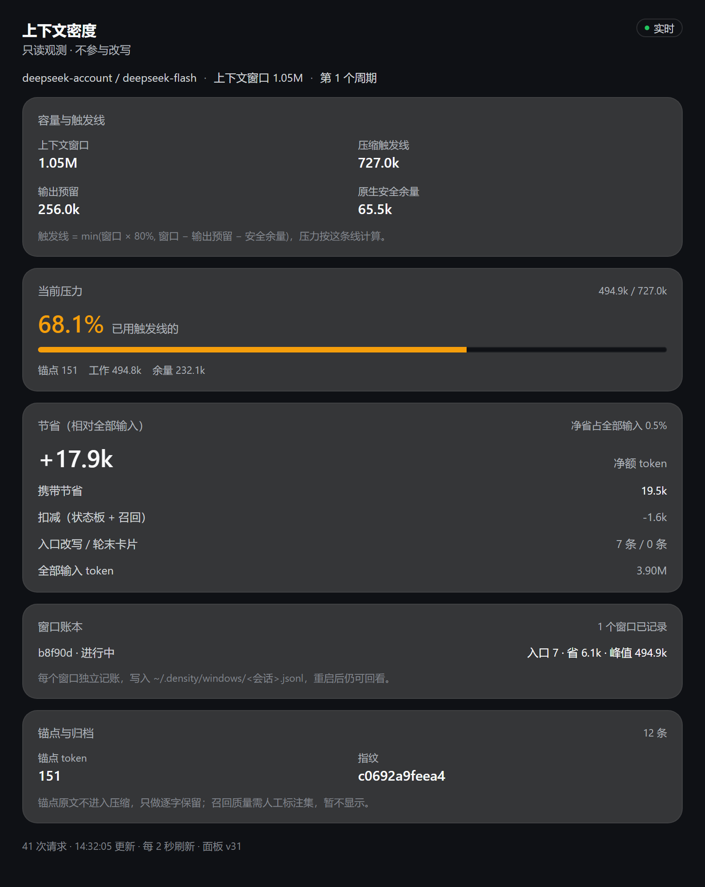

# 上下文密度（Density）· DSH 插件

质量优先的工具结果压缩：只压“压了也不丢答案”的东西，原文归档、按需召回，并按上下文窗口记账。

定位很明确——**信息密度 = 剔除噪音**，省 token 只是副产品。



*侧栏面板（示例数据）：相对原生触发线的压力、节省、每窗口账本与锚点稳定性。*

## 压什么、不压什么

| 输入 | 行为 | 依据 |
|---|---|---|
| JSON / JSONL 数组 | 转 CSV（每个值都保留） | 盲测 5/5 无损 |
| 统一 diff | 去掉未变更的上下文行 | 变更行与 hunk 头保留 |
| 日志 | 头尾 + 全部错误行 + 一行 `[统计]` 聚合 | 抽样后计数仍可答 |
| 表格 | **不压** | 盲测里行抽样把 6 题砍到 1 题 |
| 散文/长文 | **不压** | 抽样叙事文本是数据丢失，不是摘要 |
| 源码 | **不压**（v30 起） | 真实会话里大纲法被召回 58%，往返成本高于收益 |
| `cairn_*`、`density_recall` 输出 | **永不触碰** | 记忆是上下文里唯一的一份 |

压缩后的工具结果带标记 `[density #density-xxxx · 原文 NB · 用 density_recall(marker) 取回]`，
原文存进 `~/.density/archive/<会话>/`，模型可用懒注册的 `density_recall` 取回（压缩发生前零 schema 成本）。

## 安装

```yaml
- insert:
    - id: density-panel
      name: '@local/density-panel'
      config:
        mode: balanced
        write: true
        policy: quality
        surface: false
```

改配置或改代码后需重启 DSH（宿主在启动时快照插件 bundle）。

## 配置

| 键 | 默认 | 含义 |
|---|---|---|
| `mode` | `shadow` | `shadow` 只测量；`safe`/`balanced` 启用入口压缩 |
| `write` | `false` | 是否改写工具结果（真正的开关） |
| `policy` | `quality` | `strict` 只做 diff；`aggressive` 恢复旧的抽样策略（表格/头尾/代码大纲） |
| `surface` | `false` | 轮次卡替换（会改动稳定前缀，默认关） |
| `protectedTools` | `['cairn_']` | 永不压缩的工具名前缀 |
| `archiveDir` / `ledgerDir` | `~/.density/...` | 归档与账本位置 |

## 能看到什么

- 侧栏「密度」面板：容量、压力、节省、锚点、镜像、原生压缩、窗口账本。
- `GET /density/snapshot`：当前窗口 + 最近 8 个窗口的 JSON。
- 账本 `~/.density/windows/<sessionId>.jsonl`：每个窗口一行，重启后仍在。
- 指标 `~/.density/shadow/<sessionId>.jsonl`：每次压缩/召回/轮次卡。

## 开发与测试

```bash
for f in test/*.test.mjs; do node "$f"; done
```

工具：`tools/corpus-acceptance.mjs`（语料验收）、`tools/replay.mjs`（会话回放）、
`tools/repair-session-id.mjs`（修复旧版本写坏的会话 id）。

## 仓库结构

`index.js`（宿主侧）、`client.js`（面板）、`lib/`（变换/归档/账本/状态板）、`tools/`（语料验收、回放、会话修复）、`test/`、`docs/`（设计与测试记录）。

当前以 profile link 方式安装，包名 `@local/density-panel`、`private: true`。要发布成自己的包：改 `package.json` 的 name、去掉 private，并把 `cordis.patch.yml` 的 name 一起改掉，再在 profile 里重装。

## 已知限制

- 抽取式压缩，不能做语义摘要——所以散文与代码直接跳过。
- 日志抽样会丢非错误行；`[统计]` 只补回聚合计数。
- 召回成本约等于原文大小，只在缺口少时划算。
- 界面目前仅中文。

## 许可

MIT，见 [LICENSE](LICENSE)。
